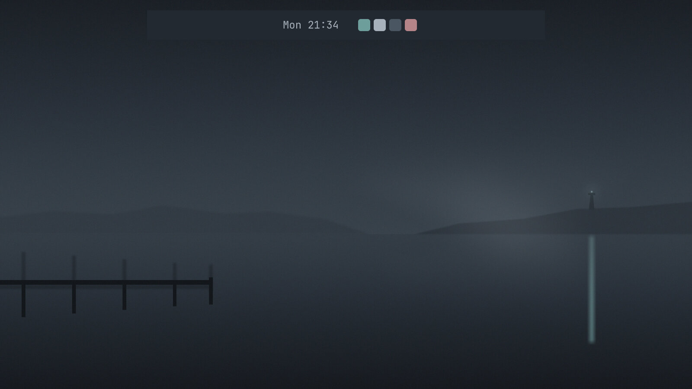

# Omarchy builds: h0 against Claude Code and opencode

Six Omarchy requests (four shell plugins and two themes), each built four times on the same model, Claude Opus
5.5, by four coding-agent harnesses: [h0](https://github.com/parker-brown-family/fitting-room) with its Omarchy
fitting, h0 without it, Claude Code, and opencode. Everything is here: the code each one wrote, every prompt, every
step, what it cost and how long it took, and a blind review of the results. They are experiments, not polished
plugins.



*Harbour Fog as h0 with its fitting built it. All four harnesses drew a foggy harbour of their own, with the network
off; the four are side by side in [builds/harbour-fog](builds/harbour-fog/README.md).*

## What we wanted to know

Is it worth using h0's Omarchy fitting, and for what exactly? Or does an off-the-shelf harness with Omarchy's own
agent skill do the job as well or better?

## How it was run

- The same first prompt for every harness, written as a person would type it ([prompts.json](prompts.json)).
- The same starting point: a copy of an Omarchy 4 home directory, with the agent-skill links Omarchy's installer
  makes on every machine, and nothing else from anyone's setup.
- The same sandbox: bubblewrap, network off. Claude Code and opencode reached the API through a proxy that held the
  key, so neither the harness nor its shell ever saw it, and every model call was metered and priced the same way.
- The same checks after every reply. When one failed, the next prompt was written from a fixed template out of what
  the check printed. At most three follow-ups; nobody edited a file.
- Each harness as shipped: Claude Code 2.1.296 (which sends `medium` effort), opencode 2.0.28, and h0 (neither of
  those two sends an effort setting, so the API default applies).

The full protocol, with the three amendments made along the way, is in [PROTOCOL.md](PROTOCOL.md).

## Results

| | passed on the first prompt | cost | model calls | minutes | review rank, plugins | review rank, themes |
|---|---|---|---|---|---|---|
| h0 + Omarchy fitting | 6 of 6 | **$4.54** | **146** | **26** | 2.9 | **1.5** |
| h0, plain | 6 of 6 | $6.89 | 230 | 31 | 2.9 | 3.5 |
| Claude Code | 5 of 6 | $8.64 | 177 | 35 | **1.75** | 3.5 |
| opencode | 5 of 6 | $9.61 | 218 | 27 | 2.5 | **1.5** |

Cost, calls and minutes count each build up to its first correct version. Three of my checks were wrong and sent
correct builds a follow-up; those are not counted, and both sets of numbers are in [PROTOCOL.md](PROTOCOL.md). Review
rank is the average place among the four (1 is best) from a blind judge, two passes per subject; see
[REVIEW.md](REVIEW.md).

| | Disk Free | Screen Sleep | Opacity | Drawer | Harbour Fog | Paper Lantern |
|---|---|---|---|---|---|---|
| best in review | h0 plain | Claude Code | Claude Code / opencode | Claude Code | h0 + fitting / opencode | h0 + fitting / opencode |
| cheapest | h0 + fitting | h0 + fitting | h0 + fitting | h0 + fitting | h0 + fitting | Claude Code |

Each subject's page compares its four builds with pictures:
[Disk Free](builds/disk-free/README.md) · [Screen Sleep](builds/screen-sleep/README.md) ·
[Opacity](builds/opacity/README.md) · [Drawer](builds/drawer/README.md) ·
[Harbour Fog](builds/harbour-fog/README.md) · [Paper Lantern](builds/paper-lantern/README.md)

## What it says

- **The fitting makes h0 cheap and quick.** It finished all six on the first prompt for about half of what Claude
  Code and opencode spent, and in the fewest calls. The fitting is a short map of where Omarchy keeps things plus two
  checks the agent runs itself, and it starts each call with about a fifth of the prompt Claude Code sends.
- **For plugins with real moving parts, Claude Code wrote the better code.** It ranked first on Screen Sleep,
  Opacity and Drawer, and the judge's reasons are about implementation: cleaner use of the shell's plugin API, better
  handling of the cases a live desktop hits. It also missed Drawer on the first try by replacing the whole bar, and
  that second prompt is why it cost the most there.
- **For themes, h0 with the fitting and opencode did best,** with Claude Code last on both.
- **The plain h0 harness was rarely best.** Without the fitting it read more and spent more, and the review placed it
  last or third on four of six.

So, for Omarchy: use the fitted h0 when you want a correct first build fast and cheaply, for a small plugin, a
config change or a theme, especially in batches or unattended. Use Claude Code with Omarchy's skill for a plugin you
will live with, where the quality of the code matters more than the dollar. A cheap h0 first pass handed to Claude
Code for review is the combination this points at, and it is untested.

## What this is not

- One session per harness per subject: an example of each, not a rate. Differences of a fraction of a review point
  are noise.
- The judge is Claude Opus 5.5, the same model that wrote every build, so it may prefer its own style; it saw all four
  builds under shuffled letters, twice.
- Plugins were checked by loading them in Quickshell offscreen and by reading their code, not on a live desktop.
  Popup panels cannot be drawn offscreen.
- Each harness ran at its own default effort; Claude Code's `medium` is not the same setting as the others' default.

## Layout

```
builds/<subject>/README.md            the four builds side by side
builds/<subject>/<harness>/files/     the plugin or theme as built
builds/<subject>/<harness>/BUILD.md   every prompt, its cost and the checks after it
builds/<subject>/<harness>/SESSION.md every step the harness took (session.png is its first screen)
builds/<subject>/<harness>/log/       raw logs: h0's hash-chained trace, or the harness's own JSON and the proxy's usage
review/                               the blind judge's answers, with the letter-to-harness mapping
tools/preview/                        loads any Omarchy plugin in Quickshell offscreen and reports what broke
tools/keyproxy.py                     lets a sandboxed harness use the API without holding the key
earlier/                              the first, h0-only run of the same six subjects
```

The plugin ideas come from the Omarchy catalog: Disk HUD, Screen Sleep and Opacity (Parker Brown; Opacity is a cut of
wicky14's Rounded Corner Blur), and Omarchy Drawer Redux by Corey Tyhurst. No harness saw their code. Omarchy is by DHH
and its contributors. MIT licence.
