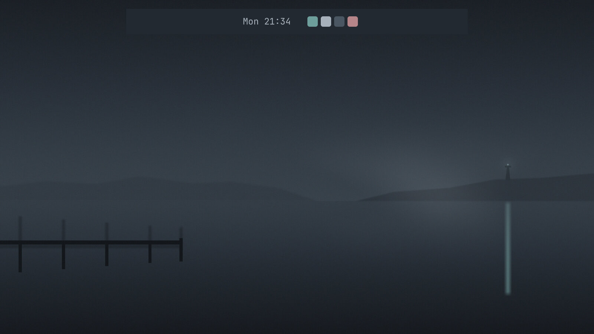
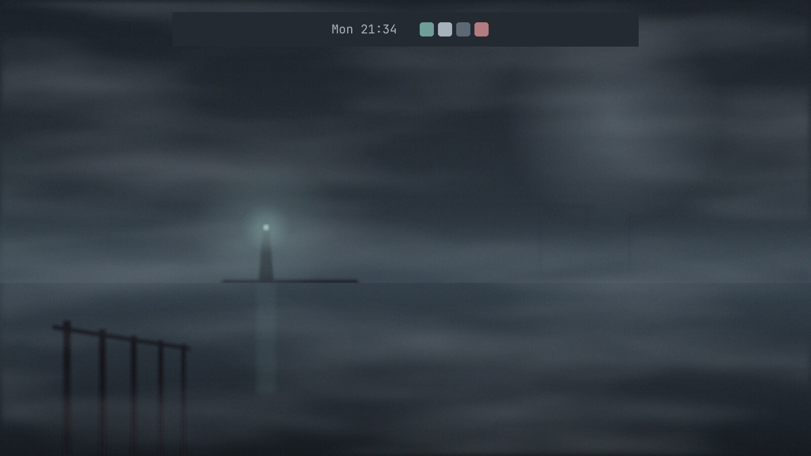
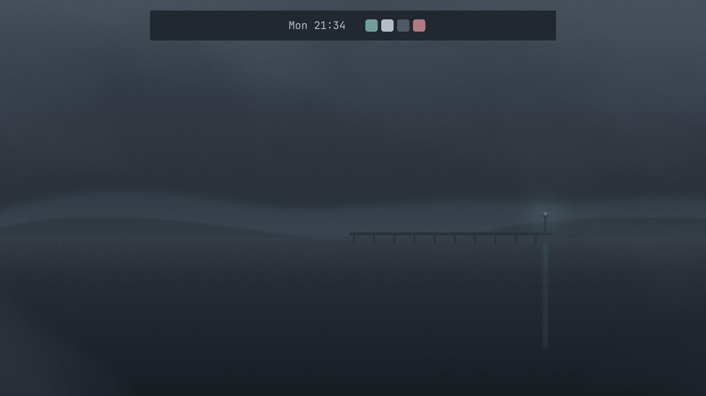
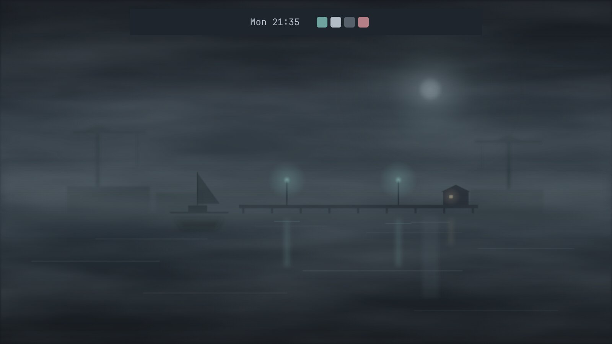

# Harbour Fog

*theme, simple*

> Make me a new Omarchy theme called Harbour Fog: cool grey-blue, low contrast, easy on the eyes late at night, with a muted teal accent. Include a background image.

| | result | prompts | model calls | cost | minutes | taste | implementation | execution | review rank |
|---|---|---|---|---|---|---|---|---|---|
| [h0 + Omarchy fitting](h0-fitted/BUILD.md) | pass | 1 | 18 | $0.39 | 6.2 | 4.5 | 4.0 | 5.0 | 1.5 |
| [h0, plain](h0-plain/BUILD.md) | pass | 2 | 36 | $0.74 | 3.5 | 2.5 | 3.5 | 4.0 | 4.0 |
| [Claude Code](claude-code/BUILD.md) | pass | 2 | 24 | $0.64 | 2.6 | 3.5 | 3.0 | 4.0 | 3.0 |
| [opencode](opencode/BUILD.md) | pass | 1 | 21 | $0.44 | 2.1 | 4.0 | 4.0 | 5.0 | 1.5 |

Review scores are 1–5 from a blind judge (Claude Opus 5.5), averaged over two passes with the builds shuffled; rank 1 is best. See [../../REVIEW.md](../../REVIEW.md) for the method and its limits.

### h0 + Omarchy fitting

### h0, plain

### Claude Code

### opencode

## What the judge said

Pass 1: opencode > h0 + Omarchy fitting > Claude Code > h0, plain. C pairs a solid palette with the most atmospheric, on-brief harbour wallpaper. A is nearly as good, with an elegant, restrained scene and a reproducible generator. D is competent but its wallpaper is sparse and has a corner artifact, and its border colour format is risky. B's smeared, muddy wallpaper undercuts an otherwise good palette and a nice gradient border.

Pass 2: h0 + Omarchy fitting > opencode > Claude Code > h0, plain. C pairs a disciplined low-contrast palette with the calmest, most liveable fog-harbour background. A is equally complete with an attractive but busier scene. D is calm but sparse and has a questionable border colour string. B's palette is fine, but its smeared background with a clashing brown railing and its light icon theme on a dark theme let it down.

Pictures are drawn by Quickshell offscreen from each build's own code, beside Omarchy's stock clock (plugins) or over the theme's own background (themes). Not desktop screenshots; popup panels cannot be drawn this way.

