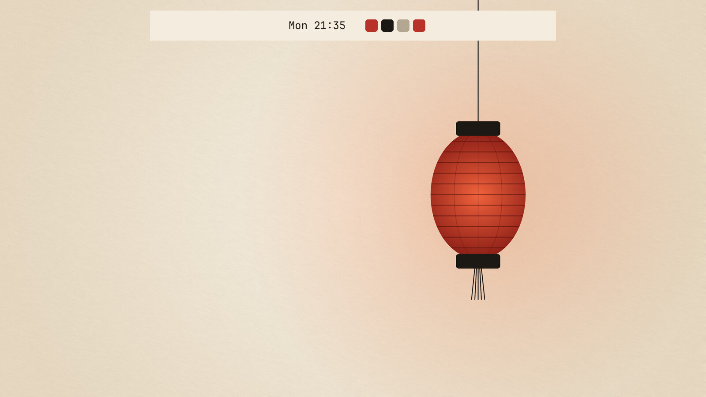
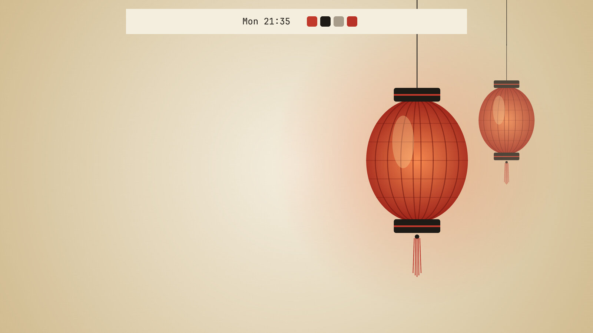
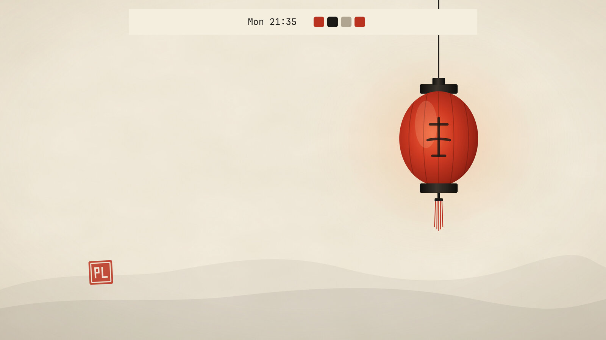
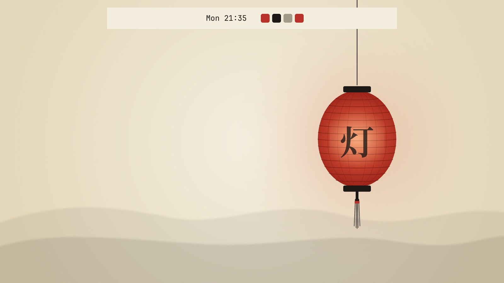

# Paper Lantern

*theme, moderate*

> Make me a light Omarchy theme called Paper Lantern: a warm off-white paper background, ink-black text, and a red lantern accent. Include a matching background image, and theme btop and my keyboard lighting too.

| | result | prompts | model calls | cost | minutes | taste | implementation | execution | review rank |
|---|---|---|---|---|---|---|---|---|---|
| [h0 + Omarchy fitting](h0-fitted/BUILD.md) | pass | 1 | 28 | $0.77 | 4.3 | 4.0 | 4.0 | 4.5 | 1.5 |
| [h0, plain](h0-plain/BUILD.md) | pass | 1 | 35 | $0.69 | 5.5 | 3.5 | 3.5 | 4.0 | 3.0 |
| [Claude Code](claude-code/BUILD.md) | pass | 1 | 16 | $0.61 | 2.0 | 2.5 | 3.0 | 4.0 | 4.0 |
| [opencode](opencode/BUILD.md) | pass | 1 | 27 | $0.73 | 3.6 | 4.0 | 3.5 | 5.0 | 1.5 |

Review scores are 1–5 from a blind judge (Claude Opus 5.5), averaged over two passes with the builds shuffled; rank 1 is best. See [../../REVIEW.md](../../REVIEW.md) for the method and its limits.

### h0 + Omarchy fitting

### h0, plain

### Claude Code

### opencode

## What the judge said

Pass 1: h0 + Omarchy fitting > opencode > h0, plain > Claude Code. A has the cleanest, most liveable paper-textured wallpaper and fully valid files, including a correctly ordered lighter_background. B's wallpaper is lovely but its btop file carries invalid gradient keys. C is busier, with a brownish wallpaper and no Chromium theme. D's monogram seal and fake glyph are gimmicky, and its keyboard format is questionable.

Pass 2: opencode > h0 + Omarchy fitting > h0, plain > Claude Code. B is complete, clean and has the most tasteful single-lantern wallpaper with an authentic glyph. D has the best paper texture but adds an unneeded generator script and a heavy glow. A is solid but has a muddier vignette and a dim keyboard red. C is let down by the PL stamp, the fake character and the '#'-prefixed keyboard.rgb.

Pictures are drawn by Quickshell offscreen from each build's own code, beside Omarchy's stock clock (plugins) or over the theme's own background (themes). Not desktop screenshots; popup panels cannot be drawn this way.

